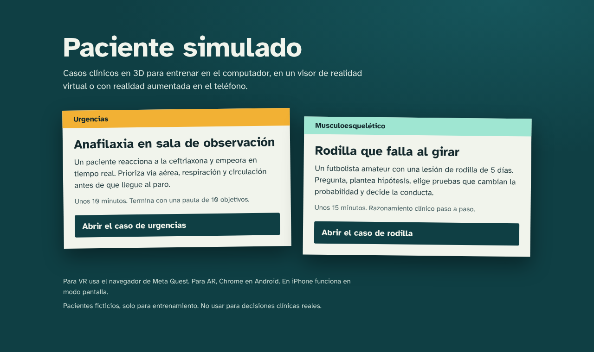
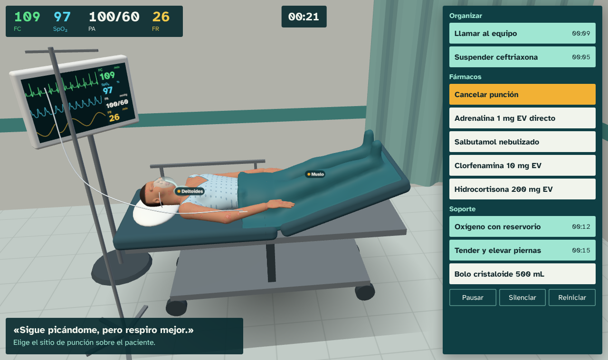
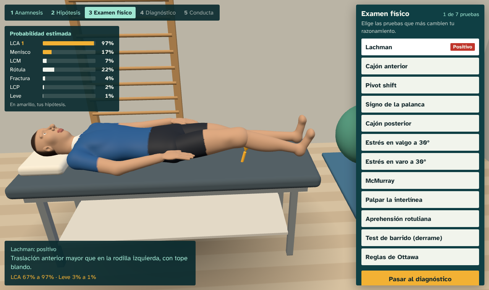

# Paciente simulado XR

Casos clínicos en 3D para entrenar en el computador, en visores de realidad virtual (Meta Quest) y en teléfonos Android con realidad aumentada. Se abre desde un menú con dos módulos.



> Pacientes ficticios, solo para entrenamiento. No usar para decisiones clínicas reales.

## Módulos

### Urgencias: anafilaxia en sala de observación



**Sr. Tapia, 46 años.** Hace 8 minutos comenzó ceftriaxona EV y ahora le pica todo el cuerpo y le cuesta respirar.

- El paciente empeora en tiempo real y, sin tratamiento, llega al paro.
- Los signos se ven en su cuerpo y en el monitor: habones, edema, palidez, cianosis, FC, SpO₂, PA y FR.
- Lo examinas tocando etiquetas sobre el paciente, con sonido de auscultación.
- Hay 10 acciones; algunas no corresponden o no son prioritarias. La adrenalina IM exige elegir el sitio de punción.
- Termina estabilizado, en paro o con síntomas persistentes, y entrega una pauta de 10 objetivos con tus tiempos.

El reloj del caso corre 3 veces más rápido que el real.

### Musculoesquelético: rodilla que falla al girar



**Matías Rojas, 24 años, futbolista amateur.** Se lesionó la rodilla derecha hace 5 días. El caso se trabaja en cinco etapas:

1. **Anamnesis:** eliges hasta 9 de 14 preguntas y Matías responde.
2. **Hipótesis:** marcas tu hipótesis principal y hasta dos alternativas.
3. **Examen físico:** eliges hasta 7 de 12 pruebas. Cada una se anima en la pierna del paciente y actualiza la probabilidad de cada hipótesis según su razón de verosimilitud.
4. **Diagnóstico:** eliges el más probable.
5. **Conducta:** marcas las indicaciones que darías hoy.

La pauta final revisa preguntas clave, banderas rojas, diagnósticos diferenciales examinados, rendimiento de las pruebas, diagnóstico y conducta.

## Cómo usarlo

### En línea (recomendado)

Publica el repositorio en Vercel, GitHub Pages o Netlify y abre el enlace. Al ser HTTPS, el visor y el teléfono entran sin avisos de seguridad. En el computador, cada caso muestra un código QR para abrirlo en el visor o el teléfono.

**Vercel:** en vercel.com elige *Add New → Project*, importa este repositorio y pulsa *Deploy*. No hay que configurar nada.

**GitHub Pages:** en el repositorio ve a *Settings → Pages*, elige la rama `main` y la carpeta `/ (root)`, y guarda.

### Sin internet

Descarga el repositorio y abre `index.html` con doble clic. Funciona en pantalla; para VR o AR hace falta publicarlo en HTTPS o usar la versión para Windows (`PacienteXR.exe`).

## Compatibilidad

| Dispositivo | Modo |
|---|---|
| Computador (Chrome, Edge, Firefox, Safari) | Pantalla, con mouse |
| Meta Quest y otros visores con WebXR | Realidad virtual y passthrough |
| Android con Chrome y ARCore | Realidad aumentada: el paciente se coloca en el piso o sobre una mesa |
| iPhone y iPad | Solo pantalla, porque Safari no ofrece WebXR |

## Base clínica

**Urgencias**

- Resuscitation Council UK. *Emergency treatment of anaphylaxis: guidelines for healthcare providers* (2021).
- World Allergy Organization. Guías de anafilaxia.

La evolución del paciente es un modelo didáctico, no un modelo farmacológico validado.

**Rodilla.** Razones de verosimilitud de las pruebas:

| Prueba | Fuente |
|---|---|
| Lachman, pivot shift | Benjaminse A et al. *J Orthop Sports Phys Ther* 2006 |
| Cajón anterior | Solomon DH et al. *JAMA* 2001 |
| Signo de la palanca | Hesmerg MK et al. *Knee* 2024 |
| Cajón posterior | Rubinstein RA et al. *Am J Sports Med* 1994 |
| McMurray, dolor en la interlínea | Hegedus EJ et al. *J Orthop Sports Phys Ther* 2007 |
| Reglas de Ottawa | Bachmann LM et al. *Ann Intern Med* 2004 |

El estrés en valgo, la aprehensión rotuliana, el test de barrido y los hallazgos de la anamnesis usan valores didácticos aproximados, para que la historia oriente sin resolver el caso por sí sola.

Revisa ambos casos contra tu protocolo local antes de usarlos con estudiantes.

## Modificar los casos

Cada página es un solo archivo HTML que se genera desde la carpeta `fuente/`. Necesitas Node.js 18 o superior.

```bash
cd fuente
npm install
npm run build   # regenera index.html, urgencias.html y rodilla.html
npm test        # corre escenarios sobre ambos casos
```

| Archivo | Contenido |
|---|---|
| `fuente/src/inicio.html` | Menú de módulos |
| `fuente/src/sim.js` | Caso de urgencias: acciones, fisiología, examen y pauta |
| `fuente/src/main.js` | Escena 3D de urgencias, monitor, sonido y modos VR, AR y pantalla |
| `fuente/src/rodilla/caso.js` | Caso de rodilla: preguntas, hipótesis, pruebas, conducta y pauta |
| `fuente/src/rodilla/main.js` | Escena de kinesiología, animación de las pruebas y modos VR, AR y pantalla |
| `fuente/gen-mesh.mjs`, `fuente/gen-mesh-rodilla.mjs` | Generan el cuerpo de cada paciente (`npm run malla`) |

Para cambiar la historia o las respuestas, edita `CASE`, `QUESTIONS` o `TESTS` en el archivo del caso y vuelve a ejecutar `npm run build`.
